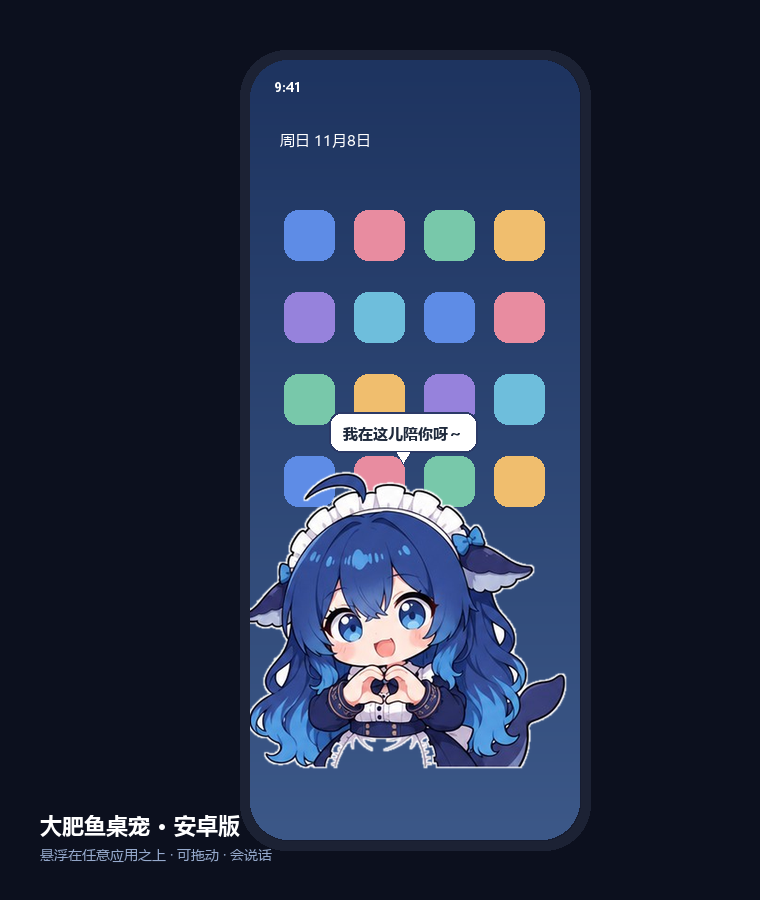

# 大肥鱼桌宠 🐋

一只住在屏幕上的大肥鱼。**电脑版**能飘在 Windows 桌面上，**安卓版**能悬浮在手机任何应用之上。

两个版本共用同一套立绘素材，全部离线运行，不联网、不上传任何数据。

| 电脑版 | 安卓版 |
| --- | --- |
|  |  |

## 功能

- **真·透明**：电脑版用 Win32 分层窗口逐像素透明，安卓版用悬浮窗，都没有白底和边框
- **能拖能戳**：拖动换位置并记住；单击有反应；双击比心；长按换表情
- **有生命**：呼吸浮动、随机自言自语、按时间段问候、偶尔自己溜达
- **说话气泡**：不挡触摸，说完自动消失
- **24 种表情**：来自表情包图库，自动抠背景生成透明立绘

## 目录

```
.
├─ dafeiyu-pet/           电脑版（Windows）
│  ├─ pet.py              主程序：Win32 分层窗口 + 动画 + 气泡
│  ├─ build_assets.py     素材处理：白底 jpg → 透明 png
│  ├─ start_pet.bat       备用启动
│  ├─ install.ps1         创建桌面快捷方式 / 开机自启
│  └─ assets/             raw 原图 + sprites 透明立绘 + 图标 + 预览
│
└─ dafeiyu-pet-android/   安卓版（Android 8.0+）
   ├─ app/src/main/java/com/dafeiyu/pet/
   │  ├─ MainActivity.java   权限、开关、大小调节
   │  ├─ PetService.java     悬浮窗 + 动画 + 气泡 + 触摸
   │  └─ PetView.java        绘制
   ├─ app/src/main/assets/sprites/   24 张透明立绘
   ├─ 大肥鱼桌宠-1.1.apk      已经打好的安装包
   └─ 重新打包.bat           本机一键重打包
```

## 电脑版（Windows）

需要 Python 3 + Pillow。

```bash
cd dafeiyu-pet
pip install pillow
python pet.py
```

或者双击 `大肥鱼桌宠.lnk`（首次先运行 `install.ps1` 生成快捷方式）。

右键有菜单：说句话 / 换表情 / 大小 / 随机走动 / 安静模式 / 藏起来 10 分钟 / 退出。

## 安卓版（Android）

**直接用现成的**：`dafeiyu-pet-android/大肥鱼桌宠-1.1.apk`，传到手机安装即可
（需要在系统里允许「显示在其他应用上层」）。

**自己编译**：

- 用 Android Studio 打开 `dafeiyu-pet-android`，`Build ▸ Build APK(s)`
- 或者命令行：`gradle assembleDebug`（需要 Android SDK platform-34）

## 自定义

- **加表情**：白底图放进 `dafeiyu-pet/assets/raw/`，跑 `python build_assets.py`，
  再把生成的 `assets/sprites/*.png` 同步到安卓工程的 `app/src/main/assets/sprites/`
- **改台词**：电脑版在 `pet.py` 的 `LINES_*`，安卓版在 `PetService.java` 的 `LINES_*`
- **改大小**：电脑版右键菜单；安卓版 App 首页「大小」四档

更多细节（环境、发版、已知坑）见 [CONTRIBUTING.md](CONTRIBUTING.md)。

## 技术说明

- 电脑版不依赖任何 GUI 框架，直接调 user32/gdi32 的 `UpdateLayeredWindow`，
  支持逐像素 alpha 和透明区域点击穿透
- 安卓版纯 Java + 原生 API，零第三方依赖，悬浮窗用
  `TYPE_APPLICATION_OVERLAY` + 前台服务保活

## 版权

代码可自由使用、修改。立绘素材来自公开表情包，仅供个人学习娱乐使用。
